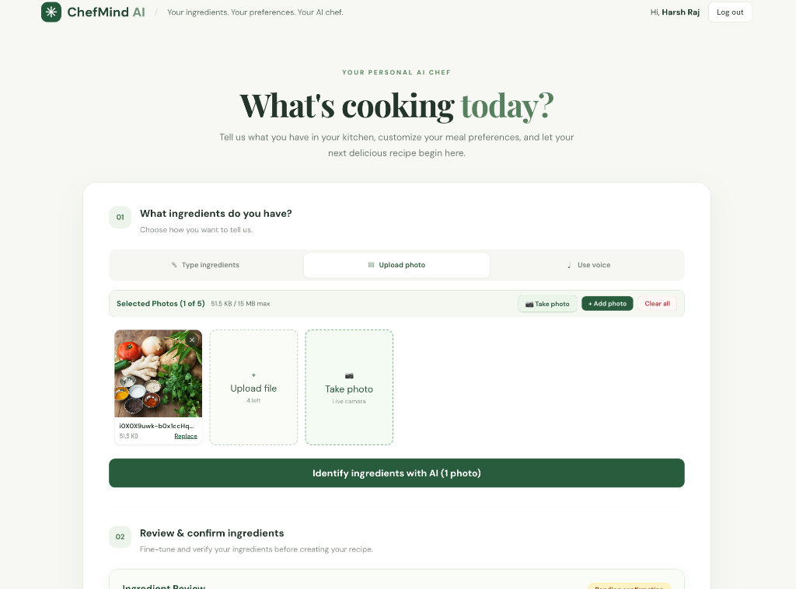
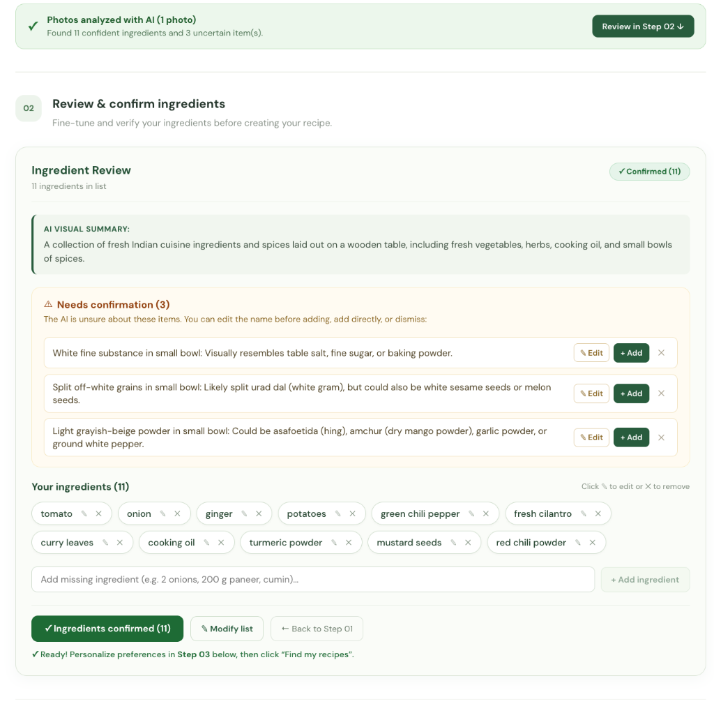
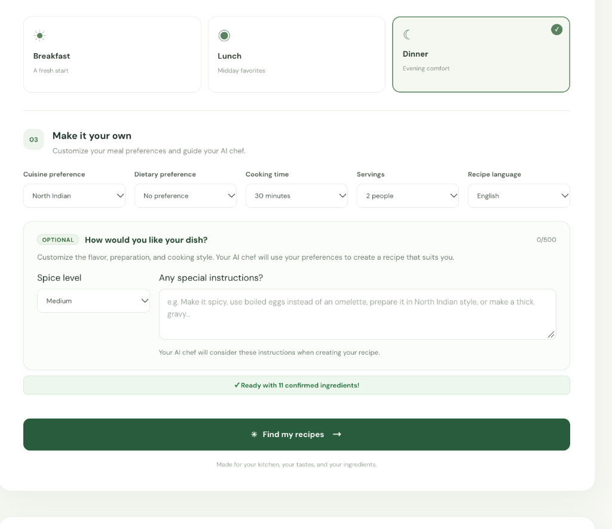
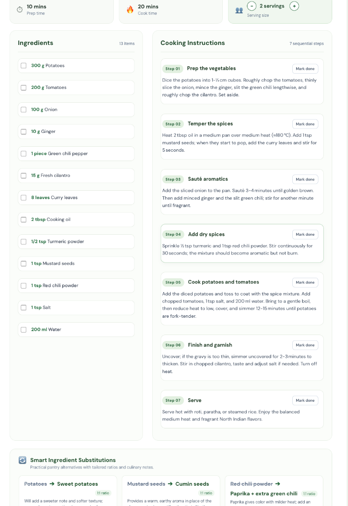
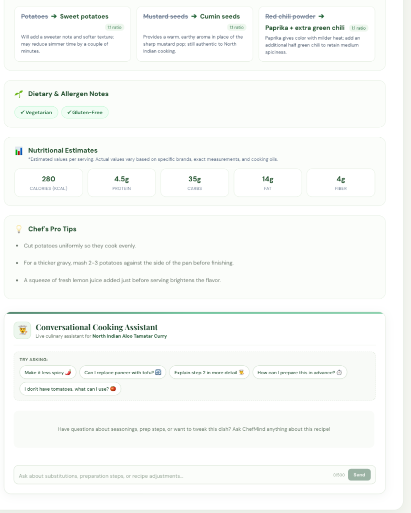
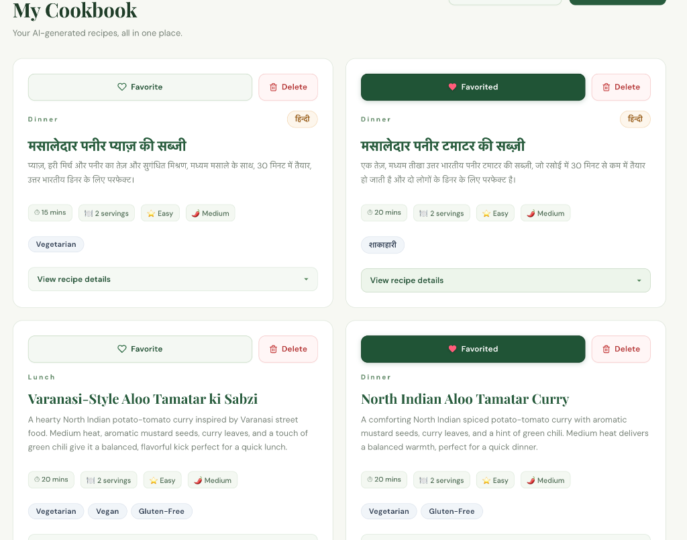
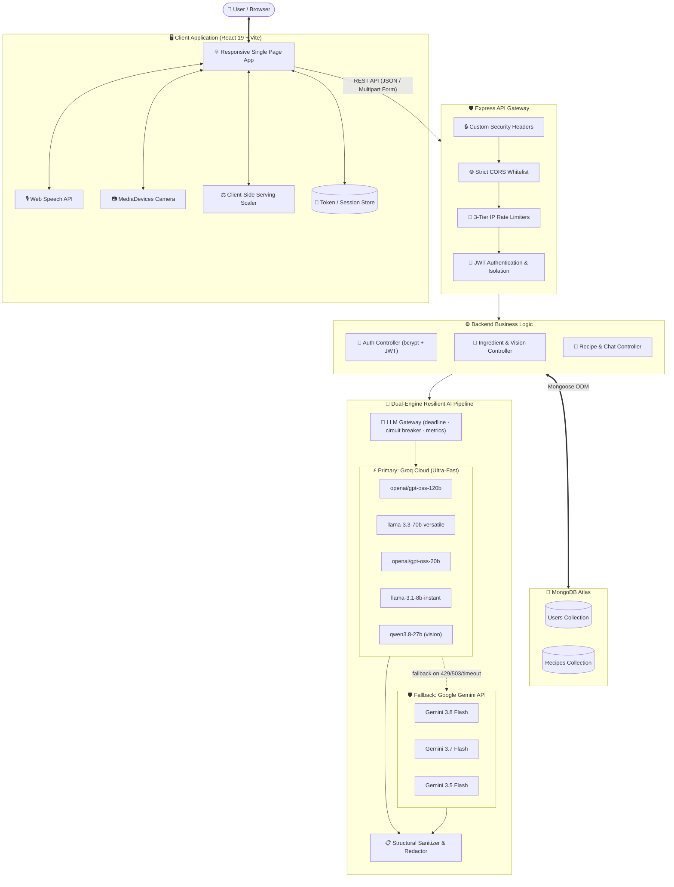

<div align="center">


# 🍳 ChefMind AI
### The Art of Culinary Intelligence · Transform Kitchen Scraps into Gourmet Creations
[](https://nodejs.org)
[](https://react.dev)
[](https://vitejs.dev)
[](https://expressjs.com)
[](https://www.mongodb.com/atlas)
[](https://groq.com)
[](https://ai.google.dev)
[](LICENSE)

<p align="center">
  🌐 <b>Live Web App:</b> <a href="https://chef-mind-ai.vercel.app" target="_blank"><b>chef-mind-ai.vercel.app</b></a>
</p>

<p align="center">
  <a href="#-application-showcase"><b>Showcase</b></a> •
  <a href="#-key-features"><b>Key Features</b></a> •
  <a href="#-system-architecture"><b>Architecture</b></a> •
  <a href="#-tech-stack"><b>Tech Stack</b></a> •
  <a href="#-quick-start"><b>Quick Start</b></a> •
  <a href="#-configuration"><b>Configuration</b></a> •
  <a href="#-rest-api-reference"><b>API</b></a> •
  <a href="#-security--hardening"><b>Security</b></a> •
  <a href="#-future-improvements"><b>Roadmap</b></a>
</p>

</div>

---

## 🌟 Overview

**ChefMind AI** is an intelligent, full-stack culinary assistant designed to solve daily mealtime decision paralysis and eliminate domestic food waste. By bridging multimodal computer vision, speech recognition, and generative AI with resilient culinary math, ChefMind turns raw pantry odds and ends into chef-grade, precisely measured recipes.

Whether you **type** your ingredients, **speak** them aloud, or **snap a picture of your refrigerator shelf**, ChefMind inspects your pantry, accommodates dietary restrictions, respects custom cooking styles, and writes fully customized recipes in **English or Hindi (हिन्दी)**.

---

## 📸 Application Showcase

### 1. Multimodal Pantry Vision & Smart Ingredient Review
<div align="center">
  
  
</div>
<p align="center"><i>Left: Upload photos or take live camera snaps · Right: AI visual pantry summary with confidence separation and uncertain item disambiguation</i></p>

### 2. Culinary Personalization & Custom Directives
<div align="center">
  
</div>
<p align="center"><i>Customize meal type, cuisine style, cooking time, servings, language (English / हिन्दी), spice level, and custom cooking instructions</i></p>

### 3. Generated Recipe with Dynamic Serving Scaler
<div align="center">
  
</div>
<p align="center"><i>Zero-latency serving scaler with salt/spice dampening, exact ingredient weights & units checklist, and sequential cooking steps</i></p>

### 4. Smart Substitutions, Macro Nutrition & AI Chef Chat
<div align="center">
  
</div>
<p align="center"><i>1:1 ingredient substitutions with ratios, macronutrient breakdown (calories, protein, carbs, fat, fiber), pro tips, and conversational AI chef chat</i></p>

### 5. Personal Cookbook with Bilingual English & Hindi Support
<div align="center">
  
</div>
<p align="center"><i>Save customized creations, toggle favorites, and browse recipes rendered natively in English and authentic Hindi (हिन्दी)</i></p>

---

## ✨ Key Features

### 🌐 Native Bilingual Recipe Engine (English & हिन्दी)
* **Devanagari Localized Output**: Seamlessly switches between English and authentic Hindi (`हिन्दी`). The AI crafts recipe titles, descriptions, units (e.g. *चम्मच*, *कटोरी*, *ग्राम*), preparation steps, chef tips, and substitutions in Devanagari script.
* **Resilient Schema Integrity**: Deep-tier JSON validation ensures backend schema keys remain unified while delivering native linguistic experiences.
* **Persistent Language State**: Recipes remember their source language when saved to your personal cookbook.

### 🧑‍🍳 Pre-Generation Culinary Directives
* **Custom Cooking Directives**: Guide the AI before generation begins—request specific appliances (e.g. *air fryer*, *cast-iron skillet*, *one-pot pressure cooker*), speed constraints (*under 20 minutes*), or culinary methods (*charred roast*, *steamed dumpling style*).
* **Granular Heat Profiles**: Five distinct heat preferences from *Mild* and *Medium* to *Authentic Indian / Extra Hot*.

### 📸 Multimodal Vision Pantry Detection
* **Camera & Multi-Image Ingestion**: Capture live photos directly via your phone/laptop camera or upload up to 5 pantry photos simultaneously.
* **AI Vision Analysis**: Leverages Groq Qwen 3.8 27B vision (with Gemini Vision fallback) and custom confidence thresholds to detect ingredients, flag uncertain items, and provide visual cooking tips.
* **Human-in-the-Loop Confirmation**: Detected ingredients flow into an interactive review tray where you can rename, adjust quantities, add forgotten spices, or delete mistaken items before generating.

### 🎙️ Hands-Free Voice Input
* **Browser Speech Recognition**: Voice-to-text dictation with multi-language accent support (`en-IN`, `en-US`, `hi-IN`). Add multiple ingredients quickly without touching the screen with floury fingers.

### ⚖️ Client-Side Serving Scaler with Culinary Math
* **Zero Latency Scaling**: Scale servings instantly from 1 to 12 persons without invoking paid AI calls.
* **Spice & Seasoning Dampening**: Prevents over-seasoning by dampening non-linear spices (salt, chilies, garam masala, saffron, cumin) during portion increases.
* **Fractional Precision**: Displays natural culinary fractions like `1 1/2 cups` or `3/4 tsp` rather than clumsy decimals like `1.7500`.

### 💬 In-Context AI Sous-Chef Chat
* **Live Recipe Iteration**: Chat with an AI assistant that maintains complete awareness of the active recipe's exact ingredients, quantities, and steps.
* **Recipe Evolution**: Request instant modifications (e.g., *"Make this dairy-free"*, *"I don't have butter, what can I substitute?"*). The assistant returns both an explanation and an updated, validated recipe object.

### 📚 Responsive Personal Cookbook
* **Cloud Persistence**: Save recipes to your MongoDB account with one click.
* **Fast Filtering & Favorites**: Filter by favorite dishes, search by title or ingredients, and scale servings directly from saved cards.
* **Engineered for Mobile (375px–430px)**: Single-column responsive layout, touch-friendly 44px hit-targets, inline SVG icons with tactile click feedback, and zero text overflow.

---

## 🏗 System Architecture

ChefMind AI is built with clean separation of concerns, defensive validation layers, and resilient model fallbacks.

### High-Level Topology



### 🧭 LLM Gateway Layer
Every model call goes through one provider-agnostic gateway ([`backend/services/llmGateway.js`](backend/services/llmGateway.js)):
* **Pluggable external gateway:** Set `LLM_GATEWAY_URL` to route through any OpenAI-compatible gateway (Cloudflare AI Gateway, Portkey, OpenRouter). Direct Groq and Gemini stay configured as automatic fallbacks.
* **Bounded latency:** One overall deadline (`LLM_DEADLINE_MS`, default 55s) caps the whole cascade, so a request can never outlive the HTTP timeout.
* **Smart error routing:** `429`/`5xx`/timeouts try the next model; `401`/`403` skip the whole provider; retired models (`404`) are skipped.
* **Circuit breaker:** A model that fails 3 times in a row is deprioritized for 60s, so it stops adding latency to every request.
* **Output validation failover:** A malformed recipe or vision payload fails over to the next model, just like an HTTP error.
* **Observability:** Structured per-attempt logs, plus per-model latency, token usage and failure metrics at `GET /api/health/ai` (opt-in via `LLM_STATS_TOKEN`).
* **Secret redaction:** Provider keys are removed from every error message that leaves the gateway.

### ⚡ Dual-Engine AI Cascade: Groq (Primary) ➔ Google Gemini (Fallback)
ChefMind AI uses an intelligent dual-engine architecture prioritizing blisteringly fast inference speeds and zero-downtime reliability:
1. **Primary Provider (Groq Cloud):** Dispatches requests to Groq's high-speed LPU inference engine (`openai/gpt-oss-120b` primary, with `llama-3.3-70b-versatile`, `openai/gpt-oss-20b`  and `llama-3.1-8b-instant` failovers; `qwen/qwen3.8-27b` for multi-modal pantry vision) with native JSON mode and 25-second per-attempt timeouts.
2. **Resilient Fallback (Google Gemini API):** If Groq encounters rate limits (`429`), upstream load (`503`), network timeouts, or unconfigured keys, ChefMind immediately and invisibly cascades to Google Gemini (`gemini-3.8-flash` ➔ `gemini-3.7-flash` ➔ `gemini-3.5-flash`), guaranteeing 100% operational availability.

```
┌──────────────────────────────────────┐      fallback on 429/503/timeout      ┌──────────────────────────────────────┐
│  ⚡ Groq Cloud (Primary Engine)      │ ────────────────────────────────────► │  🛡️ Google Gemini (Fallback Engine)  │
│  • openai/gpt-oss-120b     │                                       │  • gemini-3.8-flash (Ultra-low lat)  │
│  • llama-3.3-70b-versatile (Reason)  │                                       │  • gemini-3.7-flash (Reasoning)      │
│  • openai/gpt-oss-20b   │                                       │  • gemini-3.5-flash (Resilience)     │
│  • llama-3.1-8b-instant (Fast Fail)  │                                       │                                      │
│  • qwen3.8-27b (Multi-Image Vision)  │                                       │                                      │
└──────────────────────────────────────┘                                       └──────────────────────────────────────┘
```

---

## 🧰 Tech Stack

| Layer | Technology | Key Modules & Libraries |
|---|---|---|
| **Frontend** | **React 19** · **Vite 8** | Modern Vanilla CSS, Web Speech API, MediaDevices Camera API, Lucide-style SVG icons |
| **Backend** | **Node.js 20/22** · **Express 5** | Native ES Modules, Multer (multipart), Express Rate Limit, Native `fetch` |
| **Database** | **MongoDB Atlas** | Mongoose 9 ODM with schema validation, indexes, and strict user-scoping |
| **Artificial Intelligence** | **Groq Cloud** & **Google Gemini** | Groq (`openai/gpt-oss-120b`, `llama-3.3-70b`, `openai/gpt-oss-20b`, `llama-3.1-8b`, `qwen3.8-27b` vision) with fallback to Gemini (`3.8/3.7/3.5 Flash`) |
| **Security & Auth** | **JWT** · **bcryptjs** | Custom security headers, CORS protection, multi-tier rate limiters, magic byte inspection |
| **Testing & CI/CD** | **node:test** · **GitHub Actions** | Automated CI pipeline on Node 20 & 22 (78 unit & integration tests, ESLint, production build) |

---

## 🚀 Quick Start

### Prerequisites
* **Node.js**: `v20.0.0` or higher (verified on Node 20 & 22)
* **npm**: `v9.0.0` or higher
* **MongoDB**: A free [MongoDB Atlas](https://www.mongodb.com/atlas) connection URI (or local `mongod`)
* **Groq API Key (Recommended)**: Free from [Groq Console](https://console.groq.com)
* **Gemini API Key (Required Fallback)**: From [Google AI Studio](https://aistudio.google.com/app/apikey)

### 1. Clone the Repository
```bash
git clone https://github.com/harsh-raj00/ChefMind-AI.git
cd ChefMind-AI
```

### 2. Install Dependencies
```bash
# Install backend dependencies
npm install

# Install frontend dependencies
npm --prefix frontend install
```

### 3. Setup Environment Variables
Create your local `.env` from the provided template:
```bash
cp .env.example .env
```

Open `.env` in your editor and configure your secrets:
```ini
# Application Port & Mode
PORT=3000
NODE_ENV=development
CLIENT_URL=http://localhost:5173

# Database & Security
MONGODB_URI=mongodb+srv://<username>:<password>@cluster0.example.mongodb.net/chefmind?retryWrites=true&w=majority
JWT_SECRET=your_super_secret_at_least_32_characters_random_key

# AI Providers (Dual-Engine Cascade: Groq primary, Gemini fallback)
GROQ_API_KEY=gsk_your_groq_api_key_here
GEMINI_API_KEY=AIzaSyYourActualGeminiApiKeyHere
```

> [!NOTE]
> During local development, the Vite dev server automatically proxies `/api` requests to `http://localhost:3000`, so no frontend `.env` is necessary.

### 4. Run Development Servers
Start both backend and frontend concurrently in two terminal tabs:

```bash
# Terminal 1: Backend API (runs on http://localhost:3000 with auto-reload)
npm run dev:backend

# Terminal 2: React Frontend (runs on http://localhost:5173)
npm run dev:frontend
```

Open your browser at **`http://localhost:5173`** to begin cooking!

---
<!-- 
## ⚙️ Configuration

Only `MONGODB_URI`, `JWT_SECRET` and one AI key are required. Everything else has a sensible default. See [`.env.example`](.env.example) for the full annotated template.

| Variable | Required | Default | Purpose |
|---|---|---|---|
| `MONGODB_URI` | ✅ | — | MongoDB Atlas connection string |
| `JWT_SECRET` | ✅ | — | Token signing secret (32+ random characters in production) |
| `GROQ_API_KEY` | ⭐ Recommended | — | Primary, ultra-fast LLM provider |
| `GEMINI_API_KEY` | ✅ Fallback | — | Fallback provider (or sole provider if Groq is omitted) |
| `CLIENT_URL` | Production | `http://localhost:5173` | Comma-separated CORS allow-list |
| `LLM_GATEWAY_URL` | Optional | — | Route through an OpenAI-compatible gateway (Cloudflare AI Gateway, Portkey, OpenRouter) |
| `LLM_DEADLINE_MS` | Optional | `55000` | Total time budget for one AI request across all fallbacks |
| `LLM_ATTEMPT_TIMEOUT_MS` | Optional | `25000` | Timeout for a single model attempt |
| `GROQ_TEXT_MODELS` / `GROQ_VISION_MODELS` | Optional | built-in | Comma-separated model overrides, e.g. when a provider retires a model |
| `GEMINI_TEXT_MODELS` / `GEMINI_VISION_MODELS` | Optional | built-in | Same, for Gemini |
| `LLM_STATS_TOKEN` | Optional | — | Enables the token-protected `GET /api/health/ai` metrics endpoint |
| `LLM_LOG` | Optional | `on` | Set to `off` to silence structured per-attempt LLM logs |

--- -->
<!-- 
## 🔌 REST API Reference

All routes are prefixed with `/api`. 🔑 = requires `Authorization: Bearer <JWT>`.

| Method | Endpoint | Auth | Description |
|---|---|---|---|
| `POST` | `/auth/register` | — | Create an account (bcrypt-hashed password) |
| `POST` | `/auth/login` | — | Exchange credentials for a JWT |
| `GET` | `/auth/me` | 🔑 | Current user profile |
| `POST` | `/ingredients/image-analyze` | 🔑 | Analyze up to 5 pantry photos (JPEG/PNG/WebP, 5 MB each) |
| `POST` | `/recipes/generate` | 🔑 | Generate and save a recipe from ingredients and preferences |
| `POST` | `/recipes/chat` · `/recipes/:id/chat` | 🔑 | Ask the AI sous-chef about, or modify, a recipe |
| `POST` | `/recipes/save` | 🔑 | Save a custom or modified recipe |
| `GET` | `/recipes` | 🔑 | List your saved recipes |
| `PATCH` | `/recipes/:id/favorite` | 🔑 | Toggle favorite |
| `DELETE` | `/recipes/:id` | 🔑 | Delete a recipe |
| `GET` | `/health` · `/health/ready` | — | Liveness and database-readiness probes |
| `GET` | `/health/ai` | `LLM_STATS_TOKEN` | Per-model latency, token usage, failures and circuit state |

--- -->

## 🛡️ Security & Hardening

* **Authentication:** bcrypt password hashing, JWT sessions, and strict per-user data scoping on every recipe query.
* **Three-tier rate limiting:** Separate 15-minute windows for auth, general API, and expensive AI endpoints.
* **Strict CORS allow-list** with trailing-slash normalization and custom security headers (no external dependency).
* **Upload validation:** MIME allow-list, 5 MB per-file cap, magic-byte inspection, and in-memory buffers cleared after analysis.
* **Prompt-injection guardrails:** User directives are framed as untrusted culinary preferences, and every model response is schema-validated and sanitized server-side.
* **Secret hygiene:** Groq, Gemini and gateway keys are redacted from all error messages and logs; the frontend never sees a provider key.
* **Hermetic tests:** The test suite blanks real API keys before loading, so CI and local runs never make live AI calls.

---

## 📜 Available NPM Scripts

Run all root project commands with ease:

| Command | Action |
|---|---|
| `npm run dev:backend` | Starts the Express API server with native Node watch mode (`node --watch`) |
| `npm run dev:frontend` | Starts Vite client server with Instant Hot Module Replacement (HMR) |
| `npm test` | Runs the full 78-test backend unit and integration suite (`node:test`) |
| `npm run lint:frontend` | Runs ESLint across all React JSX and utility files |
| `npm run build:frontend` | Compiles the frontend into an optimized, minified production bundle in `frontend/dist` |
| `npm start` | Launches the production Express API server |

---

## 📁 Repository Structure

```
ChefMind-AI/
├── backend/
│   ├── controllers/             # auth · ingredient · recipe business logic
│   ├── middleware/              # JWT auth · rate limiters · file upload validators
│   ├── models/                  # Mongoose models (User, Recipe)
│   ├── routes/                  # Express route routers
│   ├── services/                # llmGateway (routing, fallback, metrics) · aiService (prompts, validation)
│   ├── tests/                   # 78 automated node:test cases (+ hermetic setup.js)
│   ├── app.js                   # Express application setup
│   └── server.js                # Server bootstrap & database connection
├── frontend/
│   ├── public/                  # Favicon, banner image & SPA _redirects rule
│   ├── src/
│   │   ├── components/          # React components (Cookbook, Hero, RecipeResult, etc.)
│   │   ├── services/            # Client API abstraction layer (auth, recipes, ingredients)
│   │   ├── utils/               # recipeScaler math & formatting helpers
│   │   ├── App.jsx              # Main app view & state workflow
│   │   ├── Auth.jsx             # Authentication modal
│   │   └── App.css              # Custom responsive stylesheet & animations
│   ├── index.html               # SPA HTML shell
│   └── vite.config.js           # Vite development server & reverse proxy
├── .env.example                 # Sanitized environment template
├── LICENSE                      # MIT Open Source License
└── package.json                 # Workspace scripts & dependencies
```

---

## 🚀 Future Improvements

1. **Verified Nutrition Data:** Replace LLM-estimated macros with a trusted nutrition database or API, recalculated live as ingredients and servings change.
2. **Substitution-Aware Recalculation:** When a substitution is applied, automatically update quantities, cooking steps, and nutrition.
3. **AI Dietitian & Personalized Recommendations:** Recommend recipes based on dietary preferences, nutrition goals, allergies, and fitness objectives. Provide daily nutrition summaries without presenting AI suggestions as medical advice.
4. **Weekly Meal Planner:** Generate personalized seven-day meal plans based on cuisine, budget, servings, available ingredients, and dietary requirements. Generate a combined shopping list with consolidated quantities.
5. **Google Health Integration:** Explore Google Health Connect on Android to use authorized activity and health data for personalized meal recommendations, subject to supported APIs and user permissions.
6. **Agentic AI with LangGraph:** Implement specialized agents for ingredient analysis, recipe planning, nutrition analysis, ingredient substitution, and dietary validation. Orchestrate them using shared state, conditional workflows, validation, and bounded retries.
7. **Nutrition Knowledge Base (RAG):** Retrieve nutrition facts from trusted sources and use them to provide evidence-based explanations.
8. **AI Observability Dashboard:** Build on the gateway's existing latency, token and failure metrics with cost tracking, traces, and recipe-quality evaluation.
9. **Smart Shopping:** Optimize shopping lists based on existing ingredients, grocery budgets, ingredient reuse, and estimated prices.

> [!TIP]
> **Implementation Guidelines:** Prioritize nutrition accuracy by using a reliable nutrition database/API instead of relying entirely on LLM calculations. Implement features incrementally, preserve existing functionality, validate dietary constraints, and evaluate each feature before deployment.

---

## 👨‍💻 Author

<div align="center">

**Harsh Raj**


*Crafted with passion, modern engineering standards, and culinary curiosity.*

⭐ **Found ChefMind AI helpful? Please give this repository a star on GitHub!**

</div>

---

## 📄 License

This project is open-source software licensed under the **[MIT License](LICENSE)**.
